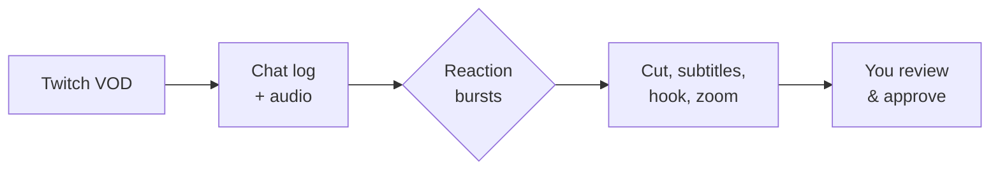

<div align="center">


# ClipIt

### Twitch highlights to Shorts. On your own machine.

**Finds the moments the chat goes wild, cuts them into vertical clips with subtitles, and waits for your OK.**

No CapCut, no manual trimming: you only review and approve.

[Get started](#get-started) · [How it works](#how-it-works) · [Configuration](#configuration) · [Roadmap](#roadmap) · [Rules of use](#rules-of-use)

[](LICENSE)
[](pyproject.toml)
[](#requirements)
[](#roadmap)

</div>

---

## What it does

| Feature | What it means |
|---|---|
| 🔎 **Finds highlights** | Reads the Twitch chat and spots bursts of reactions (laughing, hype, shock), ranked with the loudness of the stream |
| ✂️ **Cuts cleanly** | Downloads only the moments it needs and moves start and end onto sentence boundaries |
| 📱 **Makes them vertical** | 1080×1920 at 60 fps: facecam on top and gameplay below, or the whole picture over a blurred background |
| 💬 **Adds subtitles** | Local speech recognition, three words at a time, the spoken word highlighted, swear words censored |
| 🪝 **Writes the hook** | Claude suggests the on-screen hook, a title and hashtags from what was said (optional) |
| 🔍 **Zooms on the punchline** | A short zoom at the loudest moment of the clip |
| 📤 **Uploads to Shorts** | One click: into the next posting slot, scheduled on YouTube, only with the streamer's permission |
| 🖥️ **Review dashboard** | Watch, re-trim, fix subtitles, pick the hook and approve, in your browser |
| 🎚️ **Sounds right** | Loudness normalised to −14 LUFS, the level YouTube plays back at |

Any streamer, any game, any language Whisper understands: everything is set in one config file.

## How it works



A highlight is a moment when many different viewers react within a few seconds: with laughing, hype or shock emotes, typed laughter ("hahaha", "xD"), "???" or hype words. Plain chat does not count, so polls, greetings and guessing games do not look like highlights. A single spammer cannot trigger one either.

## Get started

### Requirements

- [uv](https://docs.astral.sh/uv/), which installs Python and the dependencies
- [ffmpeg](https://ffmpeg.org/download.html)
- [TwitchDownloaderCLI](https://github.com/lay295/TwitchDownloader/releases), on your `PATH` or in a `tools` folder inside the project

On Windows, keep the project in a folder with a short path such as `C:\Projects\clip-it`. Some dependencies nest their files deeply and hit the 260-character path limit otherwise.

### Install

```bash
uv sync --all-extras
```

The extras are optional: `subtitles` (speech recognition) and `ai` (hook and title suggestions). Without them ClipIt still makes clips, just without subtitles and with stock hook texts.

Copy `config.example.yaml` to `config.yaml` and `.env.example` to `.env`, then add your streamers and keys. Both files stay on your machine.

```bash
uv run python -m clip_it doctor
```

checks that tools, config and keys are in place.

### Make clips from a VOD

```bash
uv run python -m clip_it process https://www.twitch.tv/videos/<VOD id>
```

The clips land in `data/vods/<VOD id>/clip_*.mp4`. Next to them, `candidates.json` lists every clip with its time in the stream, the chat's reaction, three hook suggestions, a title, hashtags and the transcript. Highlights whose audio Twitch has muted are skipped and listed. Running the command again reuses what is already downloaded.

### Review in the dashboard

```bash
uv run python -m clip_it serve
```

Then open <http://127.0.0.1:8000>. For every clip you can:

- watch it, approve or reject it
- pick one of the three hooks or write your own, edit title and hashtags
- move start and end on the raw excerpt ("Start here", "End here")
- fix misheard subtitle words
- switch between split and blur, turn the zoom on or off
- re-render with one click (about 10 seconds; longer if a new range needs transcribing)
- download the MP4 and copy a ready TikTok caption

Edits are saved immediately. Running `process` again keeps your edits and
statuses; `process --redo` makes every clip from scratch.

To open the dashboard on your phone in the same network, set
`dashboard.lan: true` in `config.yaml` and `DASHBOARD_PASSWORD` in `.env`.
The connection is not encrypted, so only do this at home.

### Upload to YouTube

In the dashboard, **Approve & upload** sends a clip to YouTube Shorts. It goes
out at the next free posting slot (12:00, 15:00, 18:00 and 21:00 by default),
right away, or at a time you pick. ClipIt uploads it as private with that
publishing time and YouTube makes it public on its own, so your computer does
not need to be on then. **Approve without upload** only marks a clip, for
example to post it on TikTok yourself.

ClipIt refuses to upload clips of a streamer whose written permission is not
recorded (see [Rules of use](#rules-of-use)):

```yaml
streamers:
  example_streamer:
    permission:
      date: 2026-11-15
      via: Discord
      proof: example_streamer.png   # screenshot in data/permissions/
```

For your own channel, set `own_channel: true` instead.

Title, description and slots are set under `publish.youtube`. The default title
is `{title} | {streamer} #shorts`; if the clip's title already names the
streamer, the name is not added twice.

To only see what the detection finds in a chat log:

```bash
uv run python -m clip_it detect data/vods/<VOD id>/chat.json
```

## Configuration

Every setting and its default is documented in [`clip_it/defaults.yaml`](clip_it/defaults.yaml). Your `config.yaml` only needs what you want to change, globally or per streamer:

```yaml
streamers:
  example_streamer:           # the Twitch login
    display_name: Example Streamer
    language: en
    games: ["Minecraft"]      # empty = all games
    emotes:                   # the channel's own reaction emotes
      laugh: [exampleLUL]
      hype: [exampleHYPE]
```

<details>
<summary><b>Tuning the detection</b></summary>

- **Add your channel's reaction emotes** under `emotes` (`laugh`, `hype`, `shock`). Without them, a chat that reacts with its own emotes looks silent.
- **Quiet chat, few highlights?** Lower `detect.min_z` and `detect.min_rate` for that streamer. The defaults ask for about 8 reactions within 5 seconds.
- `detect` prints the chapters of a stream, so you can copy the exact game names for the `games` filter.

</details>

<details>
<summary><b>Layouts</b></summary>

- `blur` (default): the whole stream picture in the middle, over a blurred copy of itself. Works for every stream without set-up.
- `split`: facecam on top, gameplay below. Needs two rectangles per streamer, given as fractions of the stream picture:

```yaml
streamers:
  example_streamer:
    layout: split
    facecam:  {x: 0.76, y: 0.19, w: 0.24, h: 0.30}
    gameplay: {x: 0.25, y: 0.0,  w: 0.50, h: 1.0}
```

To find and check the numbers, draw them onto a frame of the stream:

```bash
uv run python -m clip_it layout-check data/vods/<VOD id>/excerpt_<n>.mp4 --streamer example_streamer
```

`data/layout_check_<streamer>.png` shows a grid with lines every 10 % (the third line from the left is x = 0.3), the facecam rectangle in yellow and the gameplay rectangle in cyan.

</details>

<details>
<summary><b>Subtitles and speech recognition</b></summary>

Subtitles use [faster-whisper](https://github.com/SYSTRAN/faster-whisper) and run locally. `subtitles.model` picks the model. On an 8-core laptop CPU, 50 seconds of speech took 10 seconds with `small` and 82 seconds with `medium`; `medium` got slang and punctuation noticeably better. The model is downloaded on first use (about 0.5 GB for `small`, 1.5 GB for `medium`).

Words from your `subtitles.censor` list are shown as `S***`; the audio stays unchanged.

</details>

<details>
<summary><b>Hook, title and hashtags</b></summary>

With an [Anthropic API key](https://console.anthropic.com) in `.env` as `ANTHROPIC_API_KEY`, Claude writes three hooks, a title and hashtags for every clip from its transcript. Each clip costs a fraction of a cent, and the transcript is sent to the Anthropic API for this. Without a key, or if a request fails, ClipIt uses stock texts that describe the chat's reaction ("Chat is dying of laughter"). Set `suggest.provider: rules` to always use those.

</details>

<details>
<summary><b>Auto-zoom</b></summary>

At the loudest moment of a clip the picture briefly zooms in (12 % for 1.2 seconds), but only if that moment is clearly louder than the rest of the clip. Change or turn it off under `render.zoom`.

</details>

<details>
<summary><b>YouTube sign-in</b> (needed for uploads)</summary>

1. Open <https://console.cloud.google.com> with the Google account that owns
   your channel and create a project.
2. **APIs & Services → Library**: enable **YouTube Data API v3**.
3. **Google Auth Platform**: app name, support email, audience **External**.
   Then, under **Audience**, choose **Publish app** to set it to
   **In production**. In "Testing" mode Google signs you out after 7 days.
   Because the app is not verified, Google shows a warning when you sign in;
   choose **Advanced** and continue. That is fine for your own use.
4. **Clients → Create client**, type **Desktop app**. Download the JSON file
   and save it as `data/google_client_secret.json`.
5. Sign in once:

```bash
uv run python -m clip_it youtube-login
```

The sign-in is stored in `data/google_token.json`. Keep it private; it is in
`.gitignore`.

</details>

<details>
<summary><b>Twitch API keys</b> (for finding new VODs and viewer clips; not needed for <code>process</code>)</summary>

1. Open <https://dev.twitch.tv/console> and log in. Twitch requires two-factor authentication on the account.
2. Choose **Register Your Application**. Name: anything unique. OAuth Redirect URL: `http://localhost`. Category: Application Integration. Client type: Confidential.
3. Open the new application with **Manage**, copy the **Client ID**, create a **New Secret** and copy it.
4. Put both into `.env` as `TWITCH_CLIENT_ID` and `TWITCH_CLIENT_SECRET`.

</details>

## Roadmap

- [x] Highlight detection from the chat
- [x] Loudness ranking, muted passages skipped
- [x] Excerpt download, split and blur layouts
- [x] Subtitles, fine cut, hook, auto-zoom
- [x] AI suggestions for hook, title and hashtags
- [x] Dashboard: preview, re-trim, edit texts, approve
- [x] YouTube Shorts upload with scheduling
- [ ] Automatic check for new VODs
- [ ] Jump cuts
- [ ] Live mode for recording while the stream runs

The full plan is in [SPEC.md](SPEC.md).

## Rules of use

- **Only clip streamers who have agreed in writing**, or your own channel.
- Label paid clips as advertising according to your local rules.
- No gambling campaigns.
- You are responsible for complying with the terms of Twitch, YouTube and TikTok.

## Development

```bash
uv run pytest
```

## Licence

[MIT](LICENSE). The spike detection is partly ported from [clippy](https://github.com/hamzaskewl/clippy); see [THIRD_PARTY_LICENSES.md](THIRD_PARTY_LICENSES.md). The bundled font Montserrat is licensed under the [SIL Open Font License](assets/fonts/OFL.txt).
